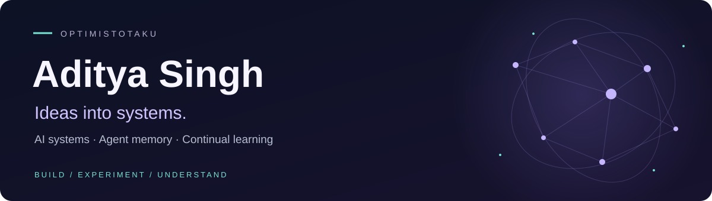

	

	
	
	

	<a href="#-selected-builds">Projects</a> ·
	<a href="#-research--the-questions-behind-the-code">Research</a> ·
	<a href="#-milestones-with-evidence">Achievements</a> ·
	<a href="https://github.com/OptimistOtaku?tab=repositories">All repositories</a>

## 👋 I'm Aditya

I build AI systems and the interfaces that make them useful. I'm especially interested in **memory, uncertainty, and continual learning**: what should a system remember, when should it change its mind, and how can we inspect the evidence behind its decisions?

That curiosity takes me from coding-agent memory and simulated robot crews to motorsport telemetry and research experiments. I enjoy taking an idea all the way through **implementation, evaluation, and an experience people can explore**.

## 🚀 Selected builds

<table>
<tr>
<td width="50%" valign="top">
<h3>🛰️ GREG</h3>

<strong>Shared knowledge. Distributed action.</strong>

A simulated robot crew coordinating through shared graph memory, evidence, and task dependencies. Gemini agents use validated MCP tools to investigate faults and recover from blocked routes or robot outages.

Python · FalkorDB · MCP · React / Three.js

<a href="https://github.com/OptimistOtaku/greg">Explore project ↗</a> · <a href="https://github.com/OptimistOtaku/greg/releases/tag/v0.1.0-demo">Watch demo</a>

</td>
<td width="50%" valign="top">
<h3>🔭 SIETCH</h3>

<strong>Memory when the signal disappears.</strong>

Edge memory for simulated rovers and drones. Local vision-language models recall observations by meaning and location, while a sync gate prioritizes what reaches mission control under a limited bandwidth budget.

Qdrant Edge · Ollama · SigLIP2 · Python

<a href="https://github.com/OptimistOtaku/Sietch">Explore project ↗</a>

</td>
</tr>
<tr>
<td width="50%" valign="top">
<h3>🧩 Recall Loop / bunch</h3>

<strong>Coding-agent memory you can inspect.</strong>

A local-first memory application with an editable 3D knowledge graph. Correct lessons, connect prerequisites and contradictions, and carry evidence-backed knowledge between sessions through hybrid retrieval and MCP.

FastAPI · SQLite · Qdrant Edge · Three.js

<a href="https://github.com/OptimistOtaku/recall-loop">Explore project ↗</a> · <a href="https://recall-loop-demo.onrender.com">Render demo</a>

</td>
<td width="50%" valign="top">
<h3>🏎️ PITWALL</h3>

<strong>Race strategy, with uncertainty in view.</strong>

Formula 1 telemetry, lap-pace forecasts, tyre-value models, and undercut analysis in an offline console. My role: AI &amp; Telemetry Engineer, covering physics identification, data pipelines, and model benchmarking.

FastF1 · scikit-learn · pandas · statsmodels

<a href="https://github.com/OptimistOtaku/trackshift-26">Explore project ↗</a>

</td>
</tr>
<tr>
<td width="50%" valign="top">
<h3>👁️ RetinAI</h3>

<strong>Computer vision for retinal research.</strong>

Built with Ayush Chaudhary: a retinal-image research pipeline combining diffusion anomaly maps, disease-specific EfficientNet-B3 models, and meta-classifier fusion, with a React interface and FastAPI inference backend.

PyTorch · Diffusers · EfficientNet · React

<a href="https://github.com/OptimistOtaku/RetinAI">Explore project ↗</a> · <a href="https://github.com/OptimistOtaku/RetinAI/blob/main/evaluation_results/all_results.json">Evaluation</a>

</td>
<td width="50%" valign="top">
<h3>🛡️ aegis-env</h3>

<strong>A training ground for AI incident response.</strong>

A reinforcement-learning environment where agents triage anomalies, contain cascading failures, patch components, and validate recovery. Adversarial logs and operational side effects make each response a sequence of consequential decisions.

Python · FastAPI · Reinforcement learning

<a href="https://github.com/OptimistOtaku/aegis-env">Explore project ↗</a>

</td>
</tr>
</table>

<strong>📸 Inside the projects</strong>

	
	
	

More experiments: [Gladiator Arena](https://github.com/OptimistOtaku/gladiator-arena) · [BudAi](https://github.com/OptimistOtaku/BudAi) · [NexusArena](https://github.com/OptimistOtaku/NexusArena) · [FieldSense](https://github.com/OptimistOtaku/FieldSense)

## 🧠 Research · the questions behind the code

### Ego Gate — what is worth remembering?

My research preview explores **uncertainty- and influence-based replay selection** for continual learning: deciding which experiences to retain under a fixed memory budget.

Part of **The Stimulus**, my longer-term exploration of selective learning. The repository includes a preprint, a small class-incremental experiment, per-seed results, and replay-baseline comparisons. Current evidence is a small-scale proof of concept.

**Questions I keep returning to:** How do we reduce forgetting? How should an agent represent doubt? How can people inspect and correct an AI system's memory?

## ✨ Milestones with evidence

| Result | What I built and measured |
| --- | --- |
| **98.6% routing accuracy · 0.998 AUC** | **RetinAI:** three-class disease routing over **2,796 evaluation images**. These are research evaluation results for the routing model, not clinical validation or DR severity-grading accuracy. [Raw metrics & confusion matrix ↗](https://github.com/OptimistOtaku/RetinAI/blob/main/evaluation_results/all_results.json) |
| **39.4% less forgetting · 20 seeds** | **Ego Gate:** combined replay selection versus random selection at the same memory budget on a small class-incremental digits benchmark. The uncertainty-only variant achieved **46.8% less forgetting** in the same study. [Paired comparisons ↗](https://github.com/OptimistOtaku/ego-gate/blob/main/results/digits/paired_comparisons.csv) |
| **60/60 recovery runs · 1.19 ms queries** | **GREG:** all six authored scenarios completed over ten deterministic repeats each. Shared-cause queries had **1.19 ms median latency** on a local graph with **5,251 nodes and 14,048 relationships**. [Benchmark evidence ↗](https://github.com/OptimistOtaku/greg/blob/main/artifacts/benchmark-results.json) |
| **53 FPS · 500 nodes · 1,195 connections** | **Recall Loop / bunch:** measured Three.js rendering on a synthetic graph in a five-second, single-device browser run. [Rendering report ↗](https://github.com/OptimistOtaku/recall-loop/blob/main/evaluation/rendering.json) |
| **12% lower error · 6,831 scored laps** | **PITWALL:** lap-pace RMSE **0.844 → 0.743 seconds** versus persistence; **92.5% empirical coverage** for nominal 90% intervals. Chronological training with a reused evaluation set. [Results & methodology ↗](https://github.com/OptimistOtaku/trackshift-26#-validated-benchmark-results) |
| **0.7–2.5 ms offline vector search** | **SIETCH:** local Qdrant Edge search latency, excluding query embedding time, in the project's recorded laptop measurements. [Measurements & limits ↗](https://github.com/OptimistOtaku/Sietch/blob/main/findings_results.md) |

## 🛠️ My toolkit

Technologies I've used across my projects, research, and contributions.

	

| Area | Technologies & techniques |
| --- | --- |
| **Languages** | Python · C++ · Rust · TypeScript · JavaScript · Solidity · SQL · HTML · CSS |
| **Frontend & interaction** | React · Next.js · Vite · Tailwind CSS · shadcn/ui / Radix UI · GSAP · Framer Motion · React Hook Form · Zod |
| **3D & visualization** | Three.js · React Three Fiber · Drei · Recharts · Chart.js · Matplotlib · SFML |
| **Backend & APIs** | FastAPI · Node.js · Express · REST APIs · Socket.IO · SQLAlchemy · Prisma · JWT authentication |
| **Machine learning & research** | PyTorch · torchvision · Hugging Face Diffusers · timm / EfficientNet · scikit-learn · NumPy · pandas · SciPy · statsmodels · FastF1 |
| **Agents & retrieval** | MCP · Gemini / OpenAI APIs · Ollama · local vision-language models · SigLIP2 · FastEmbed · dense + BM25 retrieval · reciprocal rank fusion · graph memory |
| **Databases & data engineering** | PostgreSQL · SQLite / FTS5 · Qdrant / Qdrant Edge · FalkorDB / Cypher · DuckDB · Firebase · Parquet / PyArrow · Kestra workflows |
| **Infrastructure & tooling** | Docker · Docker Compose · Render · Git / GitHub · uv · npm · Cargo · CMake · PowerShell |
| **Testing & reliability** | pytest · Vitest · React Testing Library · Node test runner · Rust regression tests · performance profiling · reproducible benchmarks · failure recovery |
| **Web3** | Solidity smart contracts · Ethereum · ethers.js · ERC-20 / ERC-721 / ERC-1155 · NFT storage integration |

---

**🌱 Giving back:** I contribute workflow blueprints to [Kestra](https://github.com/kestra-io/blueprints/pulls?q=is%3Apr+is%3Amerged+author%3AOptimistOtaku) and Rust performance improvements to [Cap](https://github.com/CapSoftware/Cap/pulls?q=is%3Apr+is%3Amerged+author%3AOptimistOtaku).

<strong>Curious about memory, learning, and the systems we can build around them.</strong> <a href="https://github.com/OptimistOtaku?tab=repositories">Explore my work ↗</a>

